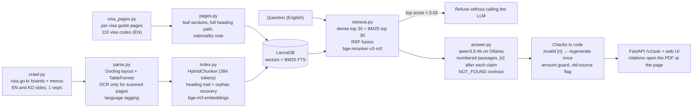

# Korea Visa Portal RAG

English question answering over the Korea Visa Portal (**visa.go.kr**). It uses two sources: the site's **English PDFs** (40 of the 107 PDFs it publishes) and its **110 English per-visa guide pages** (eligibility, required documents, visa validity and period of stay for each visa code). Every claim is cited, either to a PDF page or to a visa guide page. It runs fully locally on one 8 GB GPU. The correct source is ranked first for **88.5%** of evaluation questions and is in the top 5 for **96.7%**. Answers take **2.2 s** at the median.

## Results

All numbers come from `eval/run.py` on `eval/golden.yaml`: 61 answerable questions (45 on PDFs, 16 on visa pages, 2 of them combining both) and 9 the system must refuse. They were measured on an RTX 4060 8 GB.

**Retrieval** (`results/*-retrieval-pages.json`). A hit is a retrieved chunk from the right document that covers the right page (for visa pages: the right visa code).

| Mode | Correct source ranked 1st | In top 5 | In top 10 | MRR@10 | p50 latency |
|---|---:|---:|---:|---:|---:|
| Dense (bge-m3) | 0.754 | 0.951 | 0.967 | 0.836 | 94 ms |
| Sparse (BM25) | 0.738 | 0.951 | 0.967 | 0.828 | 3 ms |
| Hybrid (RRF) | 0.787 | 0.984 | 0.984 | 0.873 | 94 ms |
| **Hybrid + cross-encoder rerank** | **0.885** | **0.967** | **0.984** | **0.920** | 336 ms |

**Answers** (`results/20261124-1419-answers-qwen35-4b-pages-v3*`)

| Metric | qwen3.5:4b |
|---|---:|
| Answered, of 61 answerable | 61 |
| Unanswerable (9): refused, or answered "the documents do not state this" | **9** (7 refused, 2 said not stated) |
| Unanswerable answered with an invented fact | **0** |
| Correct, LLM judge (κ = 0.80 against labels assigned by Claude) | **0.934** (57/61) |
| Every claim stated in the cited passage, LLM judge (**not calibrated**) | 0.836 |
| Answers citing at least one gold source | 0.951 |
| Citation precision (cited passages that are on a gold page) | 0.832 |
| Invented citations (marker pointing to no passage) | 0 |
| End-to-end latency p50 / p95 | **2.17 s / 3.67 s** |

All 16 visa-page questions are judged correct. The four failures are PDF questions:
- **VF02 (wrong).** The PDF lays out its country tables in two columns, and Docling attaches the caption "still eligible" to the wrong table. The model then says the UK lost visa-free entry. This is a known open failure.
- **RE02, PR01 and VF04.** The central fact is right, but the model adds a wrong extra detail: it applies the multiple-permit rule to permanent residents, makes all nationals eligible instead of only professionals, or misreads a country list.

The judge is qwen3.5:9b, chosen by calibration (below).

**Generator choice** (PDF-only index, 45 questions, `results/20261124-0248-*-4b-v2*` vs `results/20261124-0228-*-9b-v2*`): qwen3.5:4b scored 0.978 correct, 2.25 s p50. qwen3.5:9b scored 0.956 correct, 20.9 s p50, because the reranker had to run on the CPU (the 9B model needs 8.9 GB).

**Corpus**

| | |
|---|---:|
| Attachment links found on visa.go.kr (English and Korean sides, 3 boards and 34 static menus) | 536 |
| Unique PDFs downloaded (the other 235 links are HWP, XLSX, DOC, images and archives) | 107 |
| English PDFs, indexed | 40 (253 pages, 810 chunks) |
| English per-visa guide pages, indexed | 110 visa codes (731 chunks) |
| Unit and data tests | `uv run pytest`: 17 passed |

> **Caveat: read before trusting the answer scores.** The golden questions and the judge-calibration labels were written by an LLM (Claude) while it read the cited sources. A human did not write them, and no human has reviewed them yet. The chunking fixes, the prompt rewrite, the amount guard and one reference-answer correction (FM05) were all made after looking at these questions, so every number is in-sample. A fresh held-out set has not been scored yet. The visa guide pages show requirements as the portal displays them for one nationality, mostly US applicants. Every page chunk says so, and the answers carry that note.

## How it works



1. **Crawl.** The portal is a JSP application. Its boards only return a detail page when the form post carries `TRAN_TYPE=ComSubmit`. Without that field the server silently returns the list page again. Attachments come from `POST /cmm/downloadFile.do`. The crawler covers both language sides and every public menu. It stores PDFs by content hash, so the same file linked from 20 posts is downloaded once. Every link, PDF or not, is recorded in `data/raw/manifest.jsonl`.
2. **Parse.** Docling runs layout analysis and TableFormer table structure, and keeps the page number and bounding box of every item. OCR runs only on documents whose text layer is mostly empty. Language is decided per document: Hangul share for Korean, and `langdetect` on the non-Hangul text to tell English from Vietnamese or Russian, which are also written in Latin or Cyrillic script. Of 107 PDFs, 40 are English or bilingual Korean/English.
3. **Chunk.** Docling's HybridChunker splits by document structure first and by the embedding model's own token budget second. Two fixes were needed on these PDFs:
   - **Orphan recovery.** A heading with no body, such as *"5. Effective Date: March 2, 2016"*, appeared in no chunk at all, so the fact was unretrievable.
   - **Heading trail.** Many of these PDFs have flat heading levels, so a chunk kept only *"Contact details:"* and lost *"Bulgaria – Competent Authority"*. Each chunk now carries the heading before its own.

   Korean and Chinese halves of bilingual forms are dropped at chunk level. Documents posted only with Korean titles get a short English title written once by the local LLM.
4. **Retrieve.** Dense retrieval (bge-m3, run in-process) and BM25 (LanceDB native full-text search) each take the top 30, fused by reciprocal rank fusion. Then the bge-reranker-v2-m3 cross-encoder re-scores the fused list. If even the best passage scores below 0.02, the system refuses without calling the LLM: 4 of the 7 unanswerable questions are refused in about 0.3 s this way. The LLM itself refuses the other 3.
5. **Visa guide pages.** `visa_pages.py` (ported from the author's earlier project) collects the portal's per-visa pages through its visa-wizard endpoints. `pages.py` turns each leaf section ("Required documents", "Visa validity…") into a chunk. Each chunk carries its full heading path, such as *Embassy visa application — Case 2 > Required documents*, the visa code and title, and a note on which nationality the page was shown for.
6. **Generate.** qwen3.5:4b gets 6 numbered passages, each with title, page and date. It must put a `[n]` after every factual sentence, or reply exactly `NOT_FOUND`. Code then checks every marker. A marker outside `1..k` is an invented citation, so the answer is regenerated once, and any invalid marker still left is removed and flagged. The response reports citation coverage, a flag for sources older than 3 years, and per-stage timings.

## Design decisions

**Hybrid + rerank instead of dense only.** These documents are full of literal tokens: visa codes (`F-2-5`), amounts (`KRW 500,000`), country lists and article numbers. On this corpus BM25 alone beats dense retrieval at every cutoff (top 5: 0.978 vs 0.933). Fusion alone ranks slightly better than BM25 (MRR 0.863 vs 0.848) but finds the right page in the top 5 a little less often. The cross-encoder is what pays: it puts the right page first for 0.867 of questions, against 0.778 for fusion, and costs about 250 ms on the GPU.

**The embedder runs in-process on the CPU.** The first version embedded queries through Ollama. Ollama then had to hold the embedder next to the generator, and the 8 GB GPU overflowed: `ollama ps` showed the generator split **30% CPU / 70% GPU**, and generation took 8–11 s. Embedding one short query on the CPU costs about 90 ms. Moving it there frees the GPU for the generator and the reranker, and generation dropped to about 2 s.

**qwen3.5:4b, not 9b.** Both ran on the same 52 questions with the same retrieval, and the larger model was not better. Correctness was 0.956 vs 0.978, every-claim-supported was 0.844 vs 0.956, and the 9B is about 9× slower on this card because it does not fit next to the reranker. A bigger generator is the wrong lever here. The errors that remain are table-reading errors, and both models make them.

**Plain-text citations, not JSON.** See "What did not work".

**Embedder and reranker models.** bge-m3 and bge-reranker-v2-m3 were chosen because they were already on the machine, and the disk had only a few GB free. Newer models (Qwen3-Embedding-0.6B, Qwen3-Reranker-0.6B, which their model cards report as stronger) were not A/B tested. That is the next retrieval experiment.

**What is not indexed.** 67 non-English PDFs (Korean, plus Vietnamese, Russian, Thai and Chinese versions of notices) and 235 non-PDF attachments (98 HWP, 79 XLSX, 31 DOC, 23 images, 4 other) are downloaded and listed in the manifest but not indexed, because the system is English-only by design. Several of them, such as the Korean visa manuals, hold substantive rules that are missing from the English side of the portal.

## What did not work
- **Prompt rules against borrowing a number from another document.** With the visa pages added, "How much does a D-2 visa cost?" retrieved D-2 pages that list "fee" as a required item but give no amount. The 4B model filled the gap with the 50,000 KRW re-entry permit fee from a notice that mentions D-2 only in its exemption list. A stronger prompt rule did not stop it, and it made another answer worse (FM04) and lowered citation precision (0.832 → 0.777), so it was reverted. What works is a check in code (`amount_guard`). When the question names a visa code, every money amount must come from a cited passage about that code: its title or section names the code, or the amount appears on the same line as the code. Otherwise the answer becomes "the documents do not state this amount for D-2". On the evaluation it fired once, on that question, and never on an answerable one.

- **JSON-schema output with thinking off.** Ollama 0.17.7 with qwen3.5 *ignores* `format` (constrained decoding) when `think: false`. The model returned `{"message": "Hello!"}` for a schema that required `ok` and `text`. With thinking on, it follows the schema but spends 800–3,400 thinking tokens first. So answers are plain text with `[n]` markers and a `NOT_FOUND` sentinel, and citations are validated in code. The same issue first made qwen3.5:9b look like a useless judge: it answered `{"is_correct": true}` instead of the schema's `verdict`, so every verdict parsed as an error until the parser accepted that shape.
- **An uncalibrated local judge.** mistral-nemo marked **45/45** answers correct, including one that reversed a fact (it said UK citizens could *not* enter visa-free, while the source lists the UK as still eligible). See `eval/judge_cases.yaml` and `eval/calibrate.py`: on 55 labelled cases (45 real answers plus 10 answers altered by hand to contain one wrong number, date, list entry or yes/no reversal), mistral-nemo with a step-by-step prompt caught 9/12 wrong answers and kept 38/43 correct ones (κ = 0.598). **qwen3.5:9b caught 11/12 and kept 40/43 (κ = 0.799)**, so it is the judge. It belongs to the same family as the generator, which risks self-preference bias. The calibration measures that risk directly on real 4B answers.
- **A verbose prompt invites errors.** The first prompt asked the model to "mention the date of dated notices". The result was filler (*"The announcement was published on…"*), one comment about the passages themselves, and an answer that opened with "Yes" to a question whose answer was "in principle, no". The second prompt is shorter and answer-first. It moved dates into code-generated flags and UI badges. Citation precision rose from 0.772 to 0.855, and the yes/no error went away (`results/20261124-0217-*` vs `results/20261124-0248-*`).
- **Bugs that looked like model failures.** Two retrieval misses came from the chunker, not the model: a dropped heading and a lost country name. The citation-support judge failed answers because it was shown 600-character snippets instead of the full cited passage.

## Run it

Requirements: Linux, an NVIDIA GPU with 8 GB, [uv](https://docs.astral.sh/uv/), and [Ollama](https://ollama.com) (tested on 0.17.7) with `qwen3.5:4b`. The judge also needs `qwen3.5:9b`.

```bash
uv sync
ollama pull qwen3.5:4b
make crawl     # ~10 min at 1 request/s -> data/raw/pdf + manifest.jsonl
make parse     # Docling -> data/parsed + catalog.jsonl
uv run python -m visarag.visa_pages   # per-visa guide pages -> data/pages/en (cached raw responses are reused)
make index     # chunks (PDFs + visa pages) + bge-m3 + LanceDB (vector + BM25)
make serve     # http://localhost:8000  (API docs at /docs)
```

```bash
curl -s localhost:8000/v1/ask -H 'content-type: application/json' \
  -d '{"question": "Who must submit a tuberculosis test certificate?"}' | jq .answer
```

Evaluation:

```bash
make test
uv run python eval/run.py retrieval                 # 4 retrieval arms
uv run python eval/run.py answers                   # end-to-end answers + latency
uv run python eval/calibrate.py --models mistral-nemo qwen3.5:9b
uv run python eval/run.py judge results/<run>-answers.jsonl --judge-model qwen3.5:9b
```

## Layout

```
src/visarag/   crawl, parse, visa_pages, pages, index, embed, retrieve, answer, ollama, api, config, static/index.html
eval/          golden.yaml (70 Q), run.py, judge_cases.yaml (55 cases), calibrate.py, resummarize.py
results/       every measured run, as JSON/JSONL
tests/         unit tests (parsers, language tagging, citations, RRF) + golden-set integrity
```

## Open items

1. **A human review of `eval/golden.yaml` and `eval/judge_cases.yaml`.** This is the largest methodological gap.
2. **Korean-only documents.** The richest rules (visa manuals) are Korean PDFs and HWP files. Indexing them needs cross-lingual retrieval and translation, which this English-only version leaves out by design.
3. **The corpus is old.** Most English notices are from 2014 to 2022. Every answer shows its source date, and the API flags sources older than three years.
