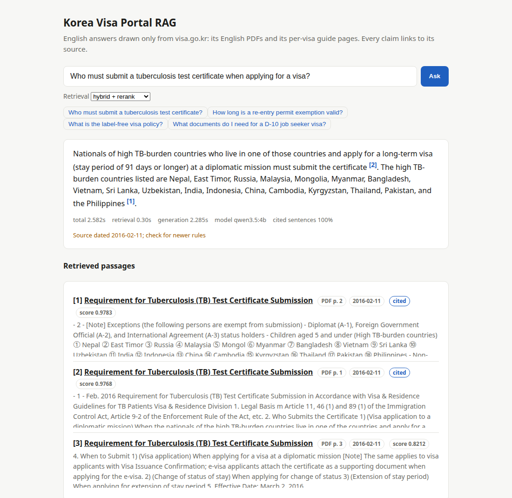
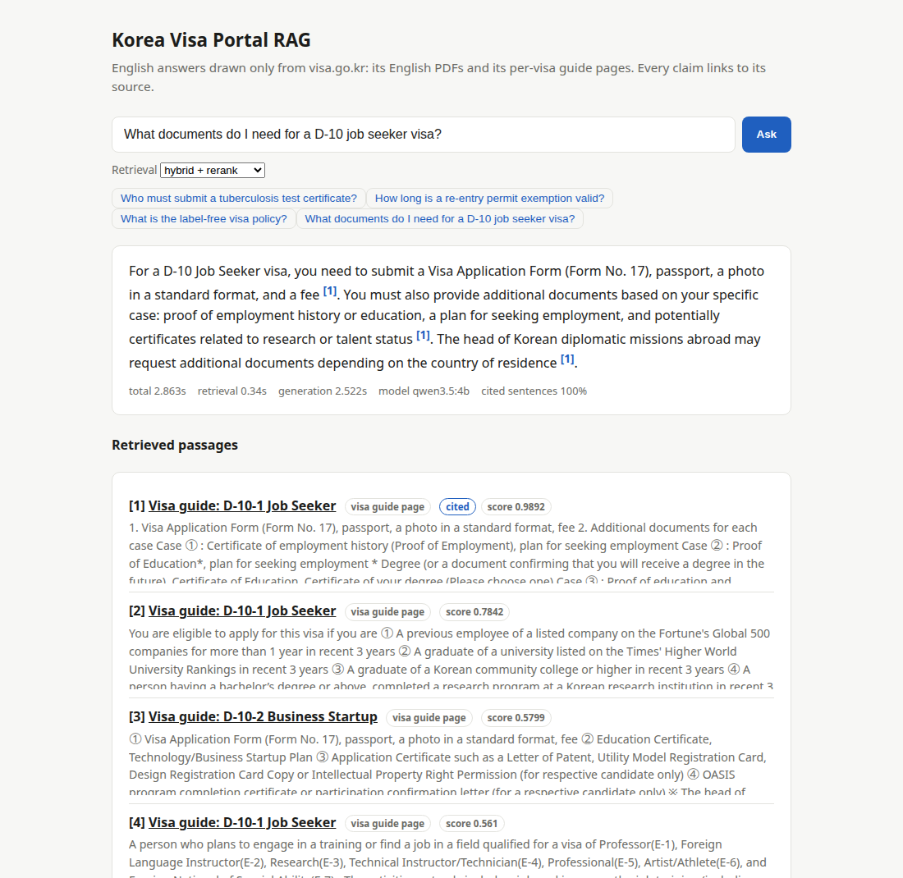
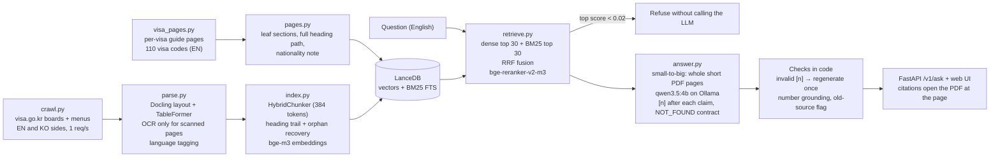

# Korea Visa Portal RAG

English question answering over the Korea Visa Portal (**visa.go.kr**), with a citation for every claim. It reads two sources: the site's **English PDFs** (40 of the 107 PDFs it publishes) and its **110 English per-visa guide pages** (eligibility, required documents, visa validity and period of stay). It runs fully locally on one 8 GB GPU and answers in **about 2 s**.

- **Retrieval:** hybrid (bge-m3 + BM25 in LanceDB), fused by reciprocal rank fusion, then a cross-encoder reranker. The right source is ranked first for **88.5%** of questions.
- **Accuracy:** **98.6%** on the 70-question development set and **94–96%** on 50 held-out questions. Read *How the held-out sets were used* for what those figures mean.
- **Guarding answers:** code checks every citation and every number against the cited passage. Questions the documents do not answer are declined.



<details><summary>Another example: an answer from a per-visa guide page</summary>



</details>

## Results

All numbers come from `eval/run.py` and were measured on an RTX 4060 8 GB. The development set (`eval/golden.yaml`) has 61 answerable questions (45 on PDFs and 16 on visa pages, 2 of them combining both) and 9 the system must decline. Each held-out set (`eval/heldout.yaml`, `eval/heldout2.yaml`) has 25 more.

**Retrieval, development set** (`results/*-retrieval-pages.json`). A hit is a retrieved chunk from the right document that covers the right page (for visa pages: the right visa code).

| Mode | Correct source ranked 1st | In top 5 | In top 10 | MRR@10 | p50 latency |
|---|---:|---:|---:|---:|---:|
| Dense (bge-m3) | 0.754 | 0.951 | 0.967 | 0.836 | 94 ms |
| Sparse (BM25) | 0.738 | 0.951 | 0.967 | 0.828 | 3 ms |
| Hybrid (RRF) | 0.787 | 0.984 | 0.984 | 0.873 | 94 ms |
| **Hybrid + cross-encoder rerank** | **0.885** | **0.967** | **0.984** | **0.920** | 336 ms |

**Answers.** Overall accuracy counts correct answers to answerable questions plus unanswerable questions that are refused or answered "the documents do not state this". The final system has small-to-big page context and number grounding; files are `results/*answers-v2-*` and `results/*answers-v3-heldout2*`.

| Set | Questions | Correct, LLM judge | Unanswerable handled | **Overall (judge)** | Overall (manual review) | p50 / p95 |
|---|---:|---:|---:|---:|---:|---:|
| Development (`golden.yaml`) | 61 + 9 | 60/61 | 9/9 | **98.6%** | 96–97% ¹ | 2.20 s / 3.74 s |
| Held-out 1 (`heldout.yaml`) | 22 + 3 | 20/22 | 3/3 | **92%** | 96% ² | 1.92 s / 3.16 s |
| Held-out 2 (`heldout2.yaml`) | 21 + 4 | 20/21 | 4/4 | **96%** | 96% | 1.86 s / 3.44 s |
| Both held-out sets | 50 | | | **94%** | **96%** | |

Other measures:
- **Invented citations:** 0 in every run.
- **Unanswerable questions answered with an invented fact:** 0 in the final runs.
- **"Every claim stated in the cited passage"** (judge, not calibrated): 0.87 / 0.91 / 0.86 on the three sets.

¹ The judge passed FM04 (it gives the paper form's "block letters" rule instead of the e-form's "uppercase only" rule), and PR01 is borderline. Both are counted as wrong in the manual column.
² The judge failed H04, whose answer (valid 3 years, first stay up to 1 year) is correct; it only omits the words "multiple-entry".

**How the held-out sets were used.** Each set was committed before the system it measures was run on it (see the commits that add `eval/heldout.yaml` and `eval/heldout2.yaml`), so first scores are not tuned. The first scoring of each one exposed failure classes that were then fixed:
- **Held-out 1, first scored at 88% (judge):**
  - The model quoted a minimum investment from memory, and number grounding was added.
  - Whole-page context hurt the 89-page apostille directory, so small-to-big is now limited to documents of 20 pages or fewer.
  - One label was wrong: H22 does have an answer in the source. The label was changed in its own commit.
- **Held-out 2, first scored at 92% (judge):**
  - K24 applied a D-3 TOPIK rule to D-4-1. Number grounding, added after held-out 1, already fixes it.
  - Then a false catch had to be fixed: a year repeated from the question.

So the honest figure for unseen questions is **about 92–96%**. The numbers in the table come after those fixes.

**Remaining errors.**
- **K05:** the model picks the wrong case on the E-3 page.
- **VF04:** the model misreads which countries a notice covers.
- **H18:** the Macao entry of the apostille directory has no country name in its chunk, so the model refuses.

**Generator choice** (PDF-only index, 45 questions, `results/20261124-0248-*-4b-v2*` vs `results/20261124-0228-*-9b-v2*`): qwen3.5:4b scored 0.978 correct, 2.25 s p50. qwen3.5:9b scored 0.956 correct, 20.9 s p50, because the reranker had to run on the CPU (the 9B model needs 8.9 GB).

**Corpus**

| | |
|---|---:|
| Attachment links found on visa.go.kr (English and Korean sides, 3 boards and 34 static menus) | 536 |
| Unique PDFs downloaded (the other 235 links are HWP, XLSX, DOC, images and archives) | 107 |
| English PDFs, indexed | 40 (253 pages, 810 chunks) |
| English per-visa guide pages, indexed | 110 visa codes (731 chunks) |
| Unit, service and data tests | `uv run pytest`: 30 passed |

> **About the evaluation data.** All 120 questions, their reference answers and the 55 judge-calibration labels were drafted by an LLM (Claude) while it read the cited sources. A review by the author is in progress, and this note will change when it is done. The development-set figures are in-sample: the chunking, prompt and guard changes were made while looking at those questions. The visa guide pages show requirements as the portal displays them for one nationality, mostly US applicants. Every page chunk says so, and the answers carry that note.

## How it works



1. **Crawl.** The portal is a JSP application. Its boards only return a detail page when the form post carries `TRAN_TYPE=ComSubmit`. Without that field the server silently returns the list page again. Attachments come from `POST /cmm/downloadFile.do`. The crawler covers both language sides and every public menu. It stores PDFs by content hash, so the same file linked from 20 posts is downloaded once. Every link, PDF or not, is recorded in `data/raw/manifest.jsonl`.
2. **Parse.** Docling runs layout analysis and TableFormer table structure, and keeps the page number and bounding box of every item. OCR runs only on documents whose text layer is mostly empty. Language is decided per document: Hangul share for Korean, and `langdetect` on the non-Hangul text to tell English from Vietnamese or Russian, which are also written in Latin or Cyrillic script. Of 107 PDFs, 40 are English or bilingual Korean/English.
3. **Chunk.** Docling's HybridChunker splits by document structure first and by the embedding model's own token budget second. Two fixes were needed on these PDFs:
   - **Orphan recovery.** A heading with no body, such as *"5. Effective Date: March 2, 2016"*, appeared in no chunk at all, so the fact was unretrievable.
   - **Heading trail.** Many of these PDFs have flat heading levels, so a chunk kept only *"Contact details:"* and lost *"Bulgaria – Competent Authority"*. Each chunk now carries the heading before its own.

   Korean and Chinese halves of bilingual forms are dropped at chunk level. Documents posted only with Korean titles get a short English title written once by the local LLM.
4. **Retrieve.** Dense retrieval (bge-m3, run in-process) and BM25 (LanceDB native full-text search) each take the top 30, fused by reciprocal rank fusion. Then the bge-reranker-v2-m3 cross-encoder re-scores the fused list. If even the best passage scores below 0.02, the system declines without calling the LLM, in about 0.3 s. Other unanswerable questions are left to the model's `NOT_FOUND` contract and to the checks in step 6.
5. **Visa guide pages.** `visa_pages.py` (ported from the author's earlier project) collects the portal's per-visa pages through its visa-wizard endpoints. `pages.py` turns each leaf section ("Required documents", "Visa validity…") into a chunk. Each chunk carries its full heading path, such as *Embassy visa application — Case 2 > Required documents*, the visa code and title, and a note on which nationality the page was shown for.
6. **Generate.** qwen3.5:4b gets up to 6 numbered passages, each with title, page and date.
   - **Small-to-big.** When a hit comes from a short PDF (20 pages or fewer), the model sees the whole page in the PDF's own text order instead of the chunk. Docling's layout model sometimes reorders a page; the text layer keeps the author's order.
   - **Citations.** The model must put a `[n]` after every factual sentence, or reply exactly `NOT_FOUND`. A marker outside `1..k` is an invented citation: the answer is regenerated once, and any invalid marker still left is removed.
   - **Number grounding.** Every number in a sentence must appear in the passages that sentence cites. Numbers repeated from the question or a source's date are allowed. A failing first sentence turns the answer into "the documents do not state this"; a failing later sentence is dropped. When the question names a visa code, a money amount must also come from a passage about that code.
   - **Response.** It reports citation coverage, a flag for sources older than three years, and per-stage timings.

## Design decisions

**Hybrid + rerank instead of dense only.** These documents are full of literal tokens: visa codes (`F-2-5`), amounts (`KRW 500,000`), country lists and article numbers. BM25 alone matches dense retrieval in the top 5 (0.951 each) at 3 ms instead of 94 ms. Fusing the two lifts the top 5 to 0.984. The cross-encoder is what pays at the top: it ranks the right source first for 0.885 of questions, against 0.787 for fusion. It gives up a little further down (top 5: 0.967 against 0.984), and costs about 250 ms on the GPU. Ranking matters more here than the top 5, because the generator reads only the first few passages.

**The embedder runs in-process on the CPU.** The first version embedded queries through Ollama. Ollama then had to hold the embedder next to the generator, and the 8 GB GPU overflowed: `ollama ps` showed the generator split **30% CPU / 70% GPU**, and generation took 8–11 s. Embedding one short query on the CPU costs about 90 ms. Moving it there frees the GPU for the generator and the reranker, and generation dropped to about 2 s.

**qwen3.5:4b, not 9b.** Both ran on the same 52 PDF-only questions with the same retrieval, and the larger model was not better: 0.956 correct for the 9B against 0.978 for the 4B. The 9B is also about 9× slower on this card, because it does not fit next to the reranker. The errors both models made were mostly context errors (a scrambled table, a wrapped line, a fact borrowed from a neighbouring page), and they were fixed by small-to-big context and number grounding, not by a bigger model.

**Plain-text citations, not JSON.** See "What did not work".

**Embedder and reranker models.** bge-m3 and bge-reranker-v2-m3 were chosen because they were already on the machine, and the disk had only a few GB free. Newer models (Qwen3-Embedding-0.6B, Qwen3-Reranker-0.6B, which their model cards report as stronger) were not A/B tested. That is the next retrieval experiment.

**What is not indexed.** 67 non-English PDFs (Korean, plus Vietnamese, Russian, Thai and Chinese versions of notices) and 235 non-PDF attachments (98 HWP, 79 XLSX, 31 DOC, 23 images, 4 other) are downloaded and listed in the manifest but not indexed, because the system is English-only by design. Several of them, such as the Korean visa manuals, hold substantive rules that are missing from the English side of the portal.

## What did not work
- **A self-verification pass.** After answering, the same 4B model checked each sentence against its cited passages and dropped the unsupported ones. This dropped correct content too: 56/61 correct with it, against 58/61 without. It is kept as an option (`VISARAG_VERIFY=true`) and is off by default. The two changes that did help are deterministic: small-to-big page context, which fixed the scrambled-table and wrapped-line errors, and number grounding, under which every number in a sentence must appear in the passages it cites.
- **Prompt rules against borrowing a number from another document.** With the visa pages added, "How much does a D-2 visa cost?" retrieved D-2 pages that list "fee" as a required item but give no amount. The 4B model filled the gap with the 50,000 KRW re-entry permit fee from a notice that mentions D-2 only in its exemption list. A stronger prompt rule did not stop it, and it made another answer worse (FM04) and lowered citation precision (0.832 → 0.777), so it was reverted. What works is a check in code (`amount_guard`, later generalised to number grounding). When the question names a visa code, every money amount must come from a cited passage about that code: its title or section names the code, or the amount appears on the same line as the code. Otherwise the answer becomes "the documents do not state this amount for D-2". On the evaluation it fired once, on that question, and never on an answerable one.
- **JSON-schema output with thinking off.** Ollama 0.17.7 with qwen3.5 *ignores* `format` (constrained decoding) when `think: false`. The model returned `{"message": "Hello!"}` for a schema that required `ok` and `text`. With thinking on, it follows the schema but spends 800–3,400 thinking tokens first. So answers are plain text with `[n]` markers and a `NOT_FOUND` sentinel, and citations are validated in code. The same issue first made qwen3.5:9b look like a useless judge: it answered `{"is_correct": true}` instead of the schema's `verdict`, so every verdict parsed as an error until the parser accepted that shape.
- **An uncalibrated local judge.** mistral-nemo marked **45/45** answers correct, including one that reversed a fact (it said UK citizens could *not* enter visa-free, while the source lists the UK as still eligible). See `eval/judge_cases.yaml` and `eval/calibrate.py`: on 55 labelled cases (45 real answers plus 10 answers altered by hand to contain one wrong number, date, list entry or yes/no reversal), mistral-nemo with a step-by-step prompt caught 9/12 wrong answers and kept 38/43 correct ones (κ = 0.598). **qwen3.5:9b caught 11/12 and kept 40/43 (κ = 0.799)**, so it is the judge. It belongs to the same family as the generator, which risks self-preference bias. The calibration measures that risk directly on real 4B answers.
- **A verbose prompt invites errors.** The first prompt asked the model to "mention the date of dated notices". The result was filler (*"The announcement was published on…"*), one comment about the passages themselves, and an answer that opened with "Yes" to a question whose answer was "in principle, no". The second prompt is shorter and answer-first. It moved dates into code-generated flags and UI badges. Citation precision rose from 0.772 to 0.855, and the yes/no error went away (`results/20261124-0217-*` vs `results/20261124-0248-*`).
- **Bugs that looked like model failures.** Two retrieval misses came from the chunker, not the model: a dropped heading and a lost country name. The citation-support judge failed answers because it was shown 600-character snippets instead of the full cited passage.

## Data

No document from visa.go.kr is stored in this repository. `make crawl` downloads the PDFs from the portal at one request per second, and `visa_pages.py` collects the per-visa guide pages. The documents belong to their publisher, the Ministry of Justice of the Republic of Korea, through the Korea Visa Portal. Answers are only as current as those documents: most English notices date from 2014 to 2022, and the API flags any answer that relies on a source older than three years.

## Run it

Requirements: Linux, an NVIDIA GPU with 8 GB, [uv](https://docs.astral.sh/uv/), and [Ollama](https://ollama.com) (tested on 0.17.7) with `qwen3.5:4b`. The judge also needs `qwen3.5:9b`.

```bash
uv sync
ollama pull qwen3.5:4b
make crawl     # ~10 min at 1 request/s -> data/raw/pdf + manifest.jsonl
make parse     # Docling -> data/parsed + catalog.jsonl
uv run python -m visarag.visa_pages   # per-visa guide pages -> data/pages/en (cached raw responses are reused)
make index     # chunks (PDFs + visa pages) + bge-m3 + LanceDB (vector + BM25)
make serve     # http://localhost:8000  (API docs at /docs)
```

```bash
curl -s localhost:8000/v1/ask -H 'content-type: application/json' \
  -d '{"question": "Who must submit a tuberculosis test certificate?"}' | jq .answer
```

Evaluation:

```bash
make test
uv run python eval/run.py retrieval                 # 4 retrieval arms
uv run python eval/run.py answers                   # end-to-end answers + latency
uv run python eval/calibrate.py --models mistral-nemo qwen3.5:9b
uv run python eval/run.py judge results/<run>-answers.jsonl --judge-model qwen3.5:9b
```

## Running it as a service

The service is built for one machine with one GPU. What is in place:

- **Logs.** One JSON line per request: request id (also returned as `X-Request-ID`), status, latency, client, and for `/v1/ask` the outcome (refused, citations, flags) and per-stage timings. Question text is not logged unless `VISARAG_LOG_QUESTIONS=true`, because people ask about their own immigration situation; by default the log has its length and a short hash.
- **Access.** `VISARAG_API_KEY` makes `/v1/*` require the `X-API-Key` header (compared in constant time); the web UI asks for the key once. The default bind address is `127.0.0.1`, and the server warns at startup if it is bound elsewhere without a key.
- **Load.** One generator on one GPU, so requests run one at a time. A per-client limit (`VISARAG_RATE_LIMIT_PER_MINUTE`, default 20) answers 429, and a bounded queue (`VISARAG_MAX_QUEUE`, default 4) answers 503, both with `Retry-After`, instead of letting threads pile up.
- **Health.** `/health` checks the index table, Ollama and the generator model, and answers 503 with the failing check.
- **Corpus refresh.** `make refresh` fetches the portal into a staging folder and reports added, removed and changed PDFs and guide pages; it never touches the live corpus (a full check takes about 25 minutes at one request per second). `make refresh-apply` swaps the new files in, parses only new PDFs and re-embeds only new text, and refuses if a download failed or the number of PDFs or pages fell by more than 10%. Read the report before applying: a guide page that loaded only partly shows up as "changed". The apply step was tested on a copy of the data with one PDF and one page removed. After a refresh the evaluation must be re-run: the numbers above belong to the 2026-11-24 snapshot.
- **Deployment files.** `Dockerfile` and `docker-compose.yml` (API + Ollama, GPU, `data/` mounted, port published on localhost only), and systemd units in `deploy/` (the API with restart on failure, and a weekly dry-run refresh timer). The image builds and its tests pass inside it; the full compose stack has not been run on a GPU host yet. The demo machine runs the API directly with uv.
- **CI.** GitHub Actions runs ruff and the tests on every push. They need no GPU, Ollama or corpus.

Not covered: more than one GPU worker, TLS (put a reverse proxy in front), shared rate limits across processes, and metrics dashboards.

## Layout

```
src/visarag/   crawl, parse, visa_pages, pages, index, embed, retrieve, answer, ollama, api, refresh, config,
               static/index.html
eval/          golden.yaml (70 Q), heldout.yaml + heldout2.yaml (25 Q each), judge_cases.yaml (55 cases),
               run.py, calibrate.py, resummarize.py
results/       every measured run, as JSON/JSONL; results/README.md maps runs to the claims above
docs/          screenshots
tests/         unit tests (parsers, language tagging, citations, RRF), service tests (key, rate limit, queue,
               health, refresh diff) + golden-set integrity
deploy/        systemd units for the API and the weekly refresh check
```

## Open items

1. **The author's review of the evaluation data** (`eval/*.yaml`) is in progress.
2. **Newer retrieval models.** Qwen3-Embedding-0.6B and Qwen3-Reranker-0.6B have not been A/B tested against bge-m3 and bge-reranker-v2-m3 yet.
3. **Korean-only documents.** The richest rules (visa manuals) are Korean PDFs and HWP files. Indexing them needs cross-lingual retrieval and translation, which this English-only version leaves out by design.
4. **The corpus is old.** Most English notices are from 2014 to 2022. Every answer shows its source date, and the API flags sources older than three years.
